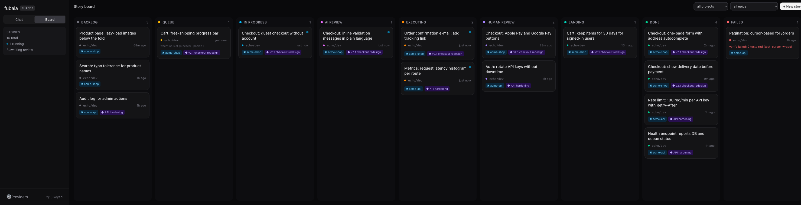

# Fubala

Self-hosted coordination plane for AI agents — a clean-room rewrite inspired by
[Auto-Claude](https://github.com/B1tMaster/Auto-Claude), rebuilt around two goals
upstream can't support: **multi-provider models** (OpenRouter, Z.ai, Ollama, …) and
**programmatic story injection for AI-agent clients**.

> **Status: phases 0–3 shipped.** Multi-provider chat, the guarded story board
> (specs, AI review, execution in worktrees, human merge), projects with
> live permission prompts, epics & dependencies, and the MCP adapter for AI
> agents. See the roadmap and the sections below.



*The story board (demo data).*

**No code was copied from upstream (AGPL-3.0).** Fubala borrows concepts only:
the spec→worktree→QA pipeline shape, status-driven execution, prompts-as-data.
The structural mistakes are deliberately designed out — see
[Design principles](#design-principles).

## Roadmap

| Phase | Scope | Status |
|---|---|---|
| 0 | Multi-provider chat: gateway, sessions, SSE streaming, web UI | ✅ done |
| 1 | Story engine: kanban board, guarded lifecycle, spec-generation pipeline, live board events | ✅ done |
| 2 | Agent execution: per-story worktrees, coder + code-review agents, permissioned tools, human merge | ✅ done |
| 3 | MCP adapter: agents file, watch, wait on and act on stories | ✅ done |
| — | Epics, dependencies (with failure cascade), projects, live permissions | ✅ done |
| next | ideas: merge-conflict resolver, parallel coder batches, story chat threads, multi-client auth | |

Phase 3 is the point of the project: AI agents (ZCode, Claude Code, …) get an MCP
server they can call to write stories, wait for them to clear the pipeline, and
review the results. The REST API below is the substrate every adapter (web UI,
MCP, future CLI) sits on.

## Architecture

```
┌──────────────┐   HTTP + SSE    ┌─────────────────────────────┐
│  web UI      │ ──────────────► │  FastAPI server             │
│  (React 19)  │                 │  ├─ story engine (phase 1)  │
└──────────────┘                 │  ├─ chat sessions           │
                                 │  ├─ ProviderGateway ────────┼──► Anthropic
┌──────────────┐   MCP (phase 3) │  │   (LiteLLM underneath) ──┼──► OpenAI
│ AI agents    │ ──────────────► │  └─ SQLite (SQLModel)       ├──► OpenRouter
└──────────────┘                 └─────────────────────────────┘ ├──► Z.ai (GLM)
                                                                 ├──► Gemini
                                                                 └──► Ollama / any
                                                                     OpenAI-compatible
```

One always-on server owns all state. Every consumer — including the bundled web
UI — is a client of the same HTTP API. All model traffic flows through a single
`ProviderGateway` interface; LiteLLM is an implementation detail behind it.

**Canonical model ids** are `provider/model` (split on the *first* slash; model
ids themselves may contain slashes, e.g. `openrouter/z-ai/glm-4.7`).

## Quickstart

Prerequisites: Python 3.12+, Node 20+, [`uv`](https://docs.astral.sh/uv/).

```bash
make install          # backend deps (uv) + frontend deps (npm)
make backend          # API on :8000 — http://localhost:8000/docs for OpenAPI
make frontend         # UI on :5173, proxies /api to the backend
```

Open http://localhost:5173. The built-in **echo** provider works with zero
configuration, so you can exercise the whole chat pipeline immediately.

### Adding & tuning providers

Providers live in the database and are managed from the **Providers** page:
click **+ Add provider**, pick a type (OpenAI, Anthropic, Z.ai, OpenRouter,
Gemini, Ollama, or custom OpenAI-compatible), and adjust anything — name, slug,
base URL, key. Every field stays editable afterwards; models can be added and
removed, each with a **skill tier** (low/medium/high) and **cost tier**
($/$$/$$$).

Keys entered in the UI are stored locally in SQLite (self-hosted tradeoff);
env vars still work as a fallback (`ANTHROPIC_API_KEY`, `ZAI_API_KEY`, …).
The built-in `echo` provider needs no key and can't be deleted.

**Live model sync:** each card has a **↻ Sync models** button that pulls the
provider's real model list (`/models` endpoints of OpenAI, Anthropic, Gemini,
OpenRouter, Z.ai, Ollama, and any compatible gateway) — no more stale presets.
New models get inferred skill/cost tiers (OpenRouter's pricing maps straight to
cost tiers); your manual tier edits are preserved; saving a key auto-syncs.
Huge catalogs are capped at 60, preferring known chat families and cheaper
models. The add-model field is a searchable combobox: it queries the
provider's live list as you type — click a suggestion to add it with inferred
tiers, or type any custom model id and Add. Non-chat families (image/video/
audio generation, embeddings) are filtered out on both paths.

**Cost-aware skill routing:** a story can request a skill tier instead of a
model (in the new-story modal: *Auto — cost-aware by skill*). At queue time the
server picks the cheapest enabled, key-configured model whose skill tier meets
the request, and stamps it on the story.

## API

Base path `/api/v1`, JSON everywhere except the message stream (SSE).
Interactive docs: http://localhost:8000/docs

| Method | Path | Purpose |
|---|---|---|
| GET | `/health` | liveness + version |
| GET | `/models` | provider/model catalog with readiness |
| POST | `/chat/sessions` | create session (`title`, `model`) |
| GET | `/chat/sessions` | list sessions |
| GET | `/chat/sessions/{id}` | session with full message history |
| PATCH | `/chat/sessions/{id}` | rename / switch model |
| DELETE | `/chat/sessions/{id}` | delete session + messages |
| POST | `/chat/sessions/{id}/messages` | send message, stream reply (SSE) |
| POST | `/stories` | create story (title, description, acceptance, model, `execution`) |
| GET | `/stories` | list stories (`?status_filter=`) |
| GET | `/stories/{id}` | story detail incl. spec + event history |
| GET | `/stories/{id}/diff` | **uncapped** worktree diff, plain text (`?download=1` for attachment) |
| PATCH | `/stories/{id}` | edit story (backlog/queued/failed only; also switch `execution`) |
| DELETE | `/stories/{id}` | delete story |
| POST | `/stories/{id}/queue` | backlog/failed → queued (scheduler picks it up) |
| POST | `/stories/{id}/unqueue` | queued → backlog |
| POST | `/stories/{id}/claim` | **external**: queued → in_progress, stamped `claimed_by` (WIP-limited) |
| POST | `/stories/{id}/complete` | **external**: claimed in_progress → human_review (code landed via PR/CI) |
| POST | `/stories/{id}/release` | **external**: stale-claim escape, in_progress → queued, claim + WIP slot freed |
| POST | `/stories/{id}/approve` | **human gate**: human_review → done |
| POST | `/stories/{id}/reject` | human_review → queued, reason fed into next spec run |
| POST | `/stories/{id}/supersede` | operator close of a **failed or human_review** story as `superseded` (work made irrelevant); gate stories get worktree/branch torn down and an open PR commented + closed best-effort; running stories (in_progress, ai_review, executing, landing) are refused with 409 — cancel first |
| GET | `/stories/events` | SSE: live `story`, `story_log` and `story_progress` events for the board |
| GET | `/providers` | provider rows with models, tiers, key status |
| GET | `/providers/presets` | the add-provider type dropdown |
| POST | `/providers` | create from a preset with overrides (slug, URL, key) |
| PATCH | `/providers/{id}` | edit name / base URL / env var / enabled |
| DELETE | `/providers/{id}` | delete provider (protected ones 409) |
| POST | `/providers/{id}/key` | store/clear the API key locally |
| POST/PATCH/DELETE | `/providers/{id}/models[/{row}]` | manage models + skill/cost tiers |

### Story lifecycle & guardrails

Stories run one of two ways, picked at creation (or until they leave the
editable statuses) via the `execution` field: `"internal"` (default — the
server's own spec → review → coder pipeline) or `"external"` (an outside
agent claims the story and lands the code itself, e.g. a Gitea PR + CI).

```
internal (default — the server owns everything after "queue"):
  backlog ── queue ──▶ queued ── scheduler ──▶ in_progress ── runner ──▶ ai_review
  ai_review ── approved ──▶ human_review ── approve ──▶ done   (the human gate)
  ai_review ── rejected ──▶ queued          (the reason feeds the next spec run)
  in_progress ── error ──▶ failed ── queue/retry ──▶ queued
  queued ── unqueue ──▶ backlog

external (an outside agent owns the in_progress phase):
  backlog ── queue ──▶ queued ── claim ──▶ in_progress ── complete ──▶ human_review ── approve ──▶ done
                     │         │ stamps        │ code already landed        └─ reject ──▶ queued
                     │         └ claimed_by    └ e.g. a Gitea PR + CI        (claim cleared, re-claimable)
                     └─ release ──▶ queued (claim cleared — the stale-claim escape)
```

**Internal** is the default path and unchanged: the server's scheduler picks
up queued internal stories, generates a spec, AI-reviews it, then (after the
human approves the spec) runs the coder agent in an isolated git worktree.

**External** exists for agents that already have their own coding loop —
another orchestrator, a CI bot, a human-driven terminal session:
1. create the story with `execution: "external"` (or switch it later while
   the story is still backlog/queued/failed),
2. `POST /stories/{id}/claim` with `{"claimed_by": "my-agent"}` — the story
   becomes `in_progress` and is now *yours*; the internal runner will never
   pick it up, not even after a server restart,
3. land the code however you work (a Gitea PR + green CI, for instance),
4. `POST /stories/{id}/complete` (optional `note`, e.g. the PR URL) — the
   story moves to `human_review`,
5. the existing human gate applies: `/approve` closes it as `done` without
   touching worktrees (the code already landed), `/reject` requeues it with
   feedback and clears the claim so it can be claimed again.

Guardrails specific to external stories:
- **Per-project WIP limit** — at most `max_external_wip_per_project`
  (default 1) claimed external stories may be `in_progress` per scope
  (project, or the global scope for stories with no project). Further claims
  get 409 until one is completed or released.
- **Stale-claim escape** — `POST /stories/{id}/release` drops the claim and
  requeues the story when the claiming agent vanished, freeing the
  per-project WIP slot it held. **Anyone may release**, not just the
  claimer: `claimed_by` is self-declared with no auth, so a claimer-only
  rule would be trivially forged and protect nothing. Identity is optional
  and self-reported via the body (`{"by": "operator"}`, default `"local"` on
  a bare POST) — recorded in the event log so the release is attributable.
- **Dependencies still gate claims** — a story with unfinished dependencies
  can't be claimed until they're `done`.
- **`claimed_by` is self-declared** — there is no auth yet, so any agent can
  claim under any name; tokens/identity land in a later phase.
- **The scheduler skips external stories entirely** — including the
  restart-orphan resume path, so an external story `in_progress` across a
  server restart stays exactly as the claiming agent left it.

### General guardrails

- **Transitions are actions, not status writes** — invalid moves can't be
  expressed; the server validates anyway (409s).
- **Two review gates**: the AI reviewer (`prompts/ai_reviewer.md`) checks the
  spec for completeness/verifiability/consistency and must approve before a
  story reaches `human_review`; an AI rejection requeues the story with the
  reason fed into the next spec run. Only the human `/approve`
  (human_review → done) closes a story, stamping `approved_by`.
- **The scheduler lives in the server** (never the UI), so stories run headless
  with no browser open. Parallelism: `FUBALA_MAX_PARALLEL_STORIES` (default 2).
- **Prompts are data**: `backend/prompts/spec_writer.md` and
  `backend/prompts/ai_reviewer.md` — edit them without touching code.
- Stories are immutable while in flight or done; failed stories keep their
  error and can be retried.

**SSE event protocol** for the message endpoint:

```
event: start  data: {"model": "zai/glm-4.7"}
event: delta  data: {"text": "..."}        # many
event: done   data: {"message_id": 42, "prompt_tokens": 3, "completion_tokens": 5, ...}
event: error  data: {"message": "...", "message_id": 43}   # on provider failure
```

Partial assistant output is persisted on error (`finish_reason: "error"`) and on
client disconnect (`finish_reason: "stopped"`).

## Development

```bash
make test      # backend pytest (fake gateway; no keys needed)
uv run pytest -q -n auto --maxprocesses=4   # same suite, xdist parallel (run from backend/);
                                            # `make test` stays serial as the no-xdist fallback
make test-frontend  # frontend store tests (vitest)
make lint      # ruff
make build     # frontend type-check + production build
```

Backend layout: `app/providers/` (catalog + gateway — the only code that knows
how models are reached), `app/routers/` (HTTP adapters), `app/models.py`
(persistence), `backend/providers.yaml` (catalog), `backend/tests/`.

## Agent tools

The chat and the story spec writer are tool-using agents backed by a small
**read-only** toolset (write access arrives with phase 2's worktrees):

- `list_files` / `read_file` / `search_files` — grounded in a **project root**
  you configure in Application settings; paths are sandboxed (traversal
  outside the root is rejected) and results are capped
- `list_stories` / `get_story` — the agent can see the board it works within

The gateway streams OpenAI-style tool calls from any provider that supports
them; the agent loop (one pump for everything) executes tools, feeds results
back, and continues until the model produces its answer (max 8 rounds). In
chat, tool calls appear live as chips; in stories they stream into the run
log. Tool activity is persisted in the assistant message. Set a project root
in **Settings → Application** to enable the filesystem tools.

### Guardrails

- **Secret redaction** — every tool result is scrubbed of secret-shaped
  strings (API keys, GitHub/Google/AWS tokens, JWTs, `password=` assignments)
  before it reaches the model, the logs, or the database
- **Sensitive-file deny-list** — `.env*`, keys/credentials, `*.sqlite`/`*.db`
  are refused outright and hidden from listings/search, plus your own globs
  (`tools_deny_globs`)
- **Budgets** — max tool calls and a wall-clock budget per agent run; once
  spent, tools are withdrawn and the model must answer with what it has
- **Stage toggles** — tools for chat and for the spec writer can be turned
  off independently
- **Injection containment** — tool output is framed as data, not
  instructions, so file contents can't hijack the agent
- All knobs live in **Settings → Application → Agent guardrails**

## Epics & dependencies

Stories can be grouped into **epics** and can **depend on each other**:

- `POST /api/v1/epics` (CRUD); stories carry `epic_id`; the board filters by
  epic (header dropdown, chips on cards) and the new-story modal creates epics
  inline
- `depends_on: [story ids]` — validated at set time (unknown ids, self-deps
  and cycles are rejected). The **scheduler will not start a story** until
  every dependency is `done`; blocked cards show what they wait on. A
  **failed dependency cascades**: waiting dependents fail too (transitively,
  with a clear error); stories already in flight keep running.
- Story detail exposes `blocking` (unfinished deps); MCP `create_story`
  accepts `epic_id` and `depends_on` so agents can file coordinated work

### Human-review notifications

When a story lands in `human_review`, the board reacts so you don't have to
watch it:

- a **toast** slides in at the bottom right — auto-dismisses after ~6 s,
  click it to open the story, ✕ to dismiss; one toast at a time (a second
  story reaching review won't fire a new one while the first is up)
- a **soft ding** plays (Web Audio, short sine decay). Browsers' autoplay
  policy may suppress it until you've interacted with the tab.

Both are driven by the board's SSE `story` events; they fire only on the
board page. To disable the sound there is no app-level toggle — mute the
tab (or the site) via the browser's tab context menu. Stories that skip
human review entirely ("Auto-approve after AI review") never notify, since
they never reach `human_review`.


## Projects & permissions (zcode-style)

Story worktrees live at `<project-root>/.fubala-worktrees/<story-id>/`
(excluded via the repo's local `.git/info/exclude`, never your tracked
`.gitignore`). The worktree is the coder's designed jail: writes there need
no permission prompt even in ask mode, while writes outside both the
worktree and the project root stay refused. Read-only agents (chat, the
spec writer) have no write tools at all — only the coder writes, only in
its worktree. Deleting a story removes its worktree.

**Projects** are workspaces: a root directory that scopes file tools, the
coder's worktree, and merges. Stories and chat sessions bind to a project
(pickers in the new-story modal and chat header; manage projects from the
Projects page). The project directory is the agent's **soft guardrail**:

- paths outside the project roots are refused with a pointer to the
  `request_permission` tool
- `request_permission(path, reason)` prompts the operator **live** (toast in
  the corner) — the agent run waits up to 120s for your Approve/Deny;
  approval also remembers the path in the project's extra allowed paths
- **Permission modes** (Settings → Application): `ask` (prompt, default),
  `strict` (deny outright), `skip` (auto-grant everything — yolo; the
  worktree jail, deny-lists and budgets still apply)

## Application settings

The settings page has an **Application** tab (everything stored in the DB,
effective live — no restart):

- **Default model** — pin one explicitly, or leave on Auto (cheapest keyed
  medium-skill model)
- **Pipeline tuning** — parallel stories (1–16) and queue poll interval
- **Auto-approve after AI review** — *deprecated: prefer per-story gates
  (`gate_spec`/`gate_code` below)* — stories with an explicit
  `VERDICT: APPROVED` skip the human gate (stamped `auto (ai-approved)`);
  unparsable verdicts always wait for a human. Off by default. Behaviour
  unchanged; it is not routed through the gate checks.
- **Gates per story (human or auto)** — every story carries `gate_spec` and
  `gate_code` (`human` by default, else `auto`). Set at create (REST, MCP
  `create_story`, or the new-story dialog), while the story is editable via
  PATCH (REST, MCP `update_story`, or the story panel), or as a project
  default (`default_gate_spec`/`default_gate_code` in Projects) that new
  stories inherit. An `auto` gate passes only when every machine check is
  green — and any failed check parks the story at that human gate with the
  failed checks named in a note (`gate_auto` event). Spec gate checks:
  `ai_spec_review_approved`, `no_human_rejection`. Code gate checks:
  `verify_green` (an unconfigured verify passes), `ai_code_review_approved`,
  `no_protected_paths`, `no_frozen_paths`, `diff_within_max`
  (added+removed vs `base_ref` ≤ the project's `auto_max_diff_lines`,
  default 400) and `no_human_rejection`. A human **reject at either gate**
  sets `human_rejected`, permanently disabling both auto gates for that
  story — a later all-green run still parks at the human gate.
- **Prompt editing** — the spec-writer and AI-reviewer system prompts are
  editable in-app with reset-to-default; a **chat system prompt** applies to
  all chat sessions
- **System** — provider/story/session counts

### Story notes (append-only work log)

`POST /api/v1/stories/{id}/notes` — append a secret-redacted work-log note
(`{body, author?}`, max 8192 bytes counted after redaction; no update/delete
routes exist). Notes show in the story panel; `GET /stories/{id}` includes
them oldest-first; the MCP tool `add_story_note` does the same for agents,
and `get_story` renders a `## Notes` tail. Notes are authored, resumable
state (STATE/VERIFIED/NEXT/BLOCKERS); events remain the system's own
record — the two timelines stay separate by design.

### Live refresh (SSE)

The board keeps one shared `EventSource` on `/api/v1/stories/events` for its
whole lifetime. `story` and `story_note` events update the list immediately
and — when the story-detail panel is open for that story — schedule a single
debounced `GET /stories/{id}` (300 ms window, so a burst of events costs one
request). Status is *never* debounced: the panel's badge reads the SSE-fresh
`stories` array, so only the detail sections can lag by up to 300 ms. Closing
the panel cancels the pending timer and does **not** close the connection; any
future event kind (e.g. run activity) just needs one extra
`scheduleDetailRefresh` line in `connectBoard`. While the panel is open the
tab title mirrors the story (`status · title`) and is restored on close.
Screenshots in this README that show a stale detail panel pre-date this
change and need re-capturing.
### URL scheme

There is no router: `App.tsx` switches on the store's `view`. The address bar
mirrors it live, and every URL is deep-linkable / refresh-safe:

```
/chat | /board | /projects | /settings      # view
?story=<story id>                            # open story-detail panel
&project=<project id>                        # board project filter
&epic=<epic id>                              # board epic filter
```

- View switches `pushState` (the back button steps between views); filter and
  panel changes `replaceState` (no history spam).
- On load, `init()` re-applies the URL after stories are loaded: `?story=` opens
  the panel through the normal `openStory` path — but only if the id exists on
  the board, so a stale link (story deleted elsewhere) is ignored rather than
  opening an empty panel.
- The `popstate` listener re-reads the location, so Back/Forward restore the
  exact view, filters and open panel.
- `vite dev` serves the SPA fallback for `/board` etc. by default, and the
  backend does the same for the built bundle — no extra config.

### Run transparency: live activity, diff viewer, budget meters

While a story runs, the story panel shows what the agent is actually doing —
live, and again after a page refresh.

**Activity feed.** `run_agent` (`backend/app/agent.py`) fires `on_progress` at
each round start and the runner wraps `on_tool`, so every round, tool call and
tool result becomes a `StoryEvent` row (`round`, `tool_call`, `tool_result`)
*and* rides the SSE bus as `story_progress`. The panel appends live events in
the browser and re-seeds from `storyDetail.events` on status-transition
refetches (live SSE events have no DB id, so a refetch is what dedupes them —
residual duplicates within one phase are cosmetic). Tool args are persisted
capped at 80 chars and tool results only record a status heuristic
(`ok`/`error`/`truncated`) — display-only, it never gates anything. Assistant
text is the closest thing to a "thinking summary" the gateway offers (thinking
tokens are not separated out); it is not faked.

**Diff viewer.** `GET /api/v1/stories/{id}/diff` serves the **uncapped**
worktree diff as plain text, folding per `diff --git` file section (hunks fold
at `@@`), with a raw download (`?download=1`). It 404s with a clear message
when the story has no `base_ref` yet, is still pre-execution, or the worktree
is missing/empty. The panel polls it on a light 5s interval while the story is
`executing` — it is read-only (scratch index), so it can't collide with the
coder's commit. The `code_diff` field on `GET /stories/{id}` stays capped at
60k — it is **legacy**, kept for old clients; the viewer uses the endpoint.

**Budget meters.** Each `round` event carries the snapshot
`{round, max_rounds, tool_calls, max_tool_calls, elapsed_s, timeout_s,
prompt_tokens, completion_tokens}` (tokens cumulative across rounds). The story
panel renders `BudgetMeters` — tool calls, rounds, "agent time" (measured from
the first round of the *current* `run_agent` call, not the whole story) and
total tokens — flipping to `near-limit` at ≥80% and `exhausted` at ≥100%.
Board cards show a compact `r{n} · t{n}/{max}` badge with the same colour
states while the story runs.
fubala/16e894bfbd0349d9a3ea93e1d0d23d09

## Third-party intake (MCP)

AI-agent clients (ZCode, Claude Code, …) can file stories and shepherd them
through the pipeline over MCP. The server speaks stdio and proxies the same
REST API the web UI uses. Add to the client's MCP settings:

```json
{
  "mcpServers": {
    "fubala": {
      "command": "uv",
      "args": [
        "run", "--directory", "/abs/path/to/fubala/backend",
        "python", "-m", "app.mcp"
      ]
    }
  }
}
```

Tools: `list_models`, `list_projects`, `list_epics`, `create_story` (model *or*
skill tier, epic, dependencies, project), `list_stories`, `get_story` (spec +
AI review + history), `story_action` (queue / unqueue / approve /
reject-with-reason) and `wait_for_story` (blocks until the story reaches a
target status). External agents additionally get `claim_story`,
`complete_story` and `release_story` (optional `released_by`, recorded in
the event), and `create_story` accepts an
`execution="external"` flag. Point it at another instance
with `FUBALA_API_URL`. Plain REST works too — see the API table.

## Design principles

Charter distilled from studying upstream Auto-Claude:

1. **One server owns state.** No orchestration in UI processes; the queue
   scheduler lives in the server, not a React component.
2. **Every consumer is an API client.** The web UI gets no privileged paths —
   if the UI can do it, an external agent can too.
3. **One gateway, wrapped at the boundary.** Provider specifics never leak past
   `ProviderGateway`; never monkey-patch SDK internals.
4. **Provider-agnostic model identity** with capability metadata from day one.
5. **Status transitions are the control plane** — moving a story to `in_progress`
   is what triggers execution (phases 1–2).
6. **Human gates stay human** until a client key is explicitly trusted.

## Security

Fubala runs AI coding agents that execute shell commands and push to your git
remotes with the credentials you give it. Run it only behind authentication on
a trusted network, never exposed to the internet. Keep provider keys and git
tokens in the settings store or env, never in the repo.

## License

MIT licensed, see `LICENSE`. Contains no code from the
AGPL-3.0 upstream — concepts and design lessons only.
